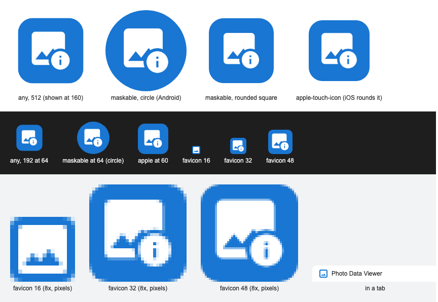

# Installable app: plan

## Goal

Photo Data Viewer can be installed from the browser as an app of its own:
Chrome and Edge offer to install the standalone site, which then opens in a
window of its own, without the browser's tabs and address bar, and has its own
icon where the system lists its apps (the Dock and Launchpad, the taskbar and
the Start menu, the home screen).

The deployment in Photo Location Map is left as it is: it is shown in that
application's window, where nothing can be installed.

## How a web app is installed today

Checked on 2026-11-18, from the sources linked below.

- **Chrome Apps are gone.** The packaged apps of the Chrome Web Store are
  discontinued. What Chrome installs now is a web app: a site that describes
  itself in a [web app manifest](https://developer.mozilla.org/docs/Web/Manifest).
  An installed web app is listed among the system's apps and opens in a window
  of its own.
- **Chrome** offers to install a page, with an icon in the address bar and an
  entry in its menu, when the page passes the check of
  [Chromium's `InstallableEvaluator`](https://chromium.googlesource.com/chromium/src/+/main/components/webapps/browser/installable/installable_evaluator.cc):
  - the page is served over HTTPS (or from `localhost`), and not in an
    Incognito or guest window;
  - it links a manifest (`<link rel="manifest">`) that can be read;
  - the manifest has a `name` or a `short_name`, and a valid `start_url`;
  - its `display` (or the first of `display_override`) is `standalone`,
    `fullscreen`, `minimal-ui` or `window-controls-overlay`;
  - it lists a square icon of at least 144 pixels for the purpose `any`, in PNG,
    SVG or WebP. [web.dev](https://web.dev/articles/install-criteria) asks for
    192 and 512 pixels.

  **No service worker is needed.** Chrome
  [dropped that requirement](https://developer.chrome.com/blog/update-install-criteria)
  in version 108 on Android and 112 on the desktop, and the check of today has
  none. A page that fails the check can still be made an app from Chrome's
  menu ("Install page as app"), with what Chrome finds on the page: its title
  and its favicon.

- **Edge** is built on Chromium and makes the same check; its address bar shows
  "App available". Microsoft's documentation says that
  ["a service worker is optional"](https://learn.microsoft.com/microsoft-edge/progressive-web-apps/how-to/#a-service-worker-is-optional)
  for Edge to install an app.
- **Safari on macOS** (Sonoma 14 and later) makes a web app of any site with
  File > Add to Dock, with or without a manifest
  ([Apple](https://support.apple.com/104996),
  [WebKit](https://webkit.org/blog/14205/news-from-wwdc23-webkit-features-in-safari-17-beta/)).
  A manifest gives it its name, start URL, theme color and display: with
  `standalone`, the window has no back and forward buttons. The user can change
  the name and the icon when adding it. No service worker is needed.
- **Safari on iPhone and iPad** adds a site with Share > Add to Home Screen.
  Since iOS 26 such a site opens as a web app unless the user turns off "Open
  as Web App". The icon on the Home Screen is the page's `apple-touch-icon`
  (180 by 180 pixels, square; the system rounds its corners), and the
  manifest's icons when there is none.
- **Firefox** installs web apps on Windows alone (version 143 and later), not on
  macOS or Linux ([Mozilla](https://support.mozilla.org/kb/web-apps-firefox-windows)).

## Changes

1. **The manifest**, `public/manifest.webmanifest`:

   | Member               | Value                                       | Why                                                                                |
   | -------------------- | ------------------------------------------- | ---------------------------------------------------------------------------------- |
   | `id`                 | `/`                                         | The app's identity, which stays the same if `start_url` changes one day.           |
   | `name`               | Photo Data Viewer                           | The app's name, the same in every language.                                        |
   | `start_url`, `scope` | `/`                                         | It opens on the Home page, and every page of the app stays in its window.          |
   | `display`            | `standalone`                                | A window of its own, without the browser's tabs and address bar.                   |
   | `background_color`   | `#ffffff`                                   | The window before the page is drawn, which is white.                               |
   | `theme_color`        | `#ffffff`                                   | The window's title bar, in the white of the app's header, so that the two are one. |
   | `icons`              | 192 and 512 pixels, and the same `maskable` | The icon where it is shown as it is, and where the system cuts it to its shape.    |

   The app's own menu goes to every page, so the window needs no back button.
   Links to other sites (GitHub, Google Maps) open in the browser, as they open
   in a new tab now.

   Left out:

   - `short_name`, a shorter name for a phone's home screen. Without it the
     home screen shows `name`, shortened by the system where it is too long.
     A shorter name would be a new name of the app.
   - `description` and `screenshots`, which Chrome shows in a larger install
     dialog. The manifest is in one language, and the app in 42.
   - `file_handlers` (open a photo with the app from Finder or Explorer) and
     `share_target` (share a photo to it on Android). Each needs code in the app;
     see [the follow-ups](./STATUS.md#follow-ups).

2. **The links**, in `src/pages/_document.tsx`: `<link rel="manifest">` and
   `<link rel="apple-touch-icon">`, in the standalone deployment alone. The
   build of Photo Location Map's deployment runs with `PDV_IN_PLM=True`, and
   its pages have neither.
3. **The icon**, proposed here and approved by the owner (see below), in every
   size that the manifest, Apple's devices and the browser's tab need. The
   favicon becomes the same icon.
4. **`scripts/generate-icons.mjs`** draws the icon and writes every file, in
   Playwright's Chromium without a window, so that a change to the drawing is
   one command.
5. **A browser test** asks Chrome, through the DevTools protocol, whether the
   app can be installed, and checks that the browser offers it
   (`beforeinstallprompt`) and that each icon is the size the manifest gives it.

## The icon

A photo with an "i" for its information: the Material icons
[`photo` and `info`](https://fonts.google.com/icons?icon.set=Material+Icons),
which the app's menu already shows through `@mui/icons-material`, in white on
`#1976d2`, the blue of MUI's default theme that the app's buttons and tabs are
in. Photo Location Map's icon is a white drawing on blue as well.

Google's Material Icons are
[under the Apache License 2.0](https://github.com/google/material-design-icons):
"Feel free to remix and re-share these icons … in your products", and
attribution is "not required".

| File                                        | Pixels     | Shape                                                                                          |
| ------------------------------------------- | ---------- | ---------------------------------------------------------------------------------------------- |
| `public/icons/icon-192.png`, `icon-512.png` | 192, 512   | A rounded square with the margin of a macOS app icon, its corners transparent: shown as it is. |
| `public/icons/icon-maskable-*.png`          | 192, 512   | Blue to the edges, the drawing inside the middle 80%, which any shape the system cuts keeps.   |
| `public/apple-touch-icon.png`               | 180        | Blue to the edges; iPhone and iPad round the corners.                                          |
| `public/favicon.ico`                        | 16, 32, 48 | The tab's icon. At 16 pixels the photo alone, as the "i" is a blur at that size.               |

The favicon was the triangle that came with Create Next App, Vercel's logo,
which is not the app's. With the new one, the tab, the bookmarks and the
installed app show the same icon. Both deployments serve the same `public`
folder, so Photo Location Map's has the new favicon too; its window does not
show one.

## Working offline

Not added. A service worker is what would let the app open without the
network, and none is needed to install it (above).

- What would work offline: reading the EXIF data, which the app does in the
  browser.
- What would not: the map's tiles, the fonts from Google Fonts and the
  analytics. The app would open with the system's fonts and an empty map.
- The risk: a service worker that keeps the app's files serves the version it
  kept. After a deployment, the installed app would open the earlier version at
  least once, and a mistake in the worker's own updating can keep an old
  version until each user clears the site's data. Next.js names its scripts by
  their content, so a worker that kept the pages but not every script they ask
  for would open a broken page.
- Without a service worker, an installed app opened without the network shows
  [Chrome's page for an app that is offline](https://developer.chrome.com/blog/default-offline),
  with the app's icon (Chrome 109 on Android, 110 on the desktop), not the page
  of a site that cannot be reached.

If it is wanted later: answer the pages from the network first and from the
cache when the network fails, keep `/_next/static/` (whose names change with
their content) in the cache, leave other sites' requests alone, and register
the worker in the standalone deployment alone. [Serwist](https://serwist.pages.dev/)
(`@serwist/next`) does this for Next.js.
